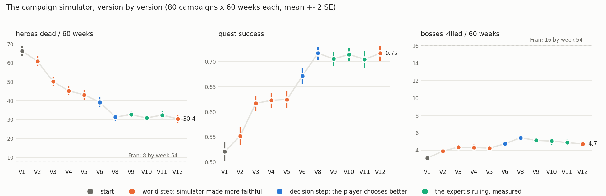

# CAMPAIGN_SIM — the campaign simulator

Agreed with Fran on **2026-10-10**. This is the project's closing arc; read it
before starting any night's work, and do not open work that is not on it.

## Why

The live bridge plays the real game at the real game's speed: one campaign at
a time, a stuck screen every night, no way to iterate. Combat got good because
it had a simulator; **the campaign layer (Hamlet, progression, quest choice)
has never had one**, so it never improved. This builds that simulator, so the
campaign layer can be measured and improved the way combat was.

It supersedes `docs/OBJECTIVES.md` (2026-10-06, "beat the game better than
Fran" in the LIVE game), whose capability table and bottleneck ranking still
hold as context.

The deliverable is a portfolio piece (TFG level) and a narrative video: a
learning curve of campaigns, "weeks to kill the Heart" falling, and the
chronicle of the best campaign told as a story.

## Scope — fixed

- **Every DLC** (Crimson Court incl. Courtyard and the Crimson Curse, Color of
  Madness, Shieldbreaker, Musketeer, Fire's Edge). The Farmstead is optional
  content and comes last.
- **Darkest difficulty** (`modes/base`), not Radiant, not Stygian.
- **No mods.**
- **Nothing of Red Hook's is ever published**: no decompiled code, no
  `docs/DECOMP.md` content, no game data files. The simulator reads the local
  install; a public repo must need the reader's own copy of the game.

## Architecture

```
CampaignState (week, roster, wallet, heirlooms, buildings, trinkets,
               districts, curse, dungeon levels, plot progress)
   │  each week:
   ├─ to_town_state()  ──►  bridge.townplan.advise / embarkplan.plan_embark
   │                        (pure over TownState: the CURRENT live policy is
   │                         the baseline, unchanged)
   ├─ quest board       ◄── campaign/quest/*.generation.json, plot_quests
   ├─ expedition        ──► env.expedition_sequence_env + the PPO policy
   │                        (+ NEW: gold, heirlooms, trinkets, curios, XP)
   └─ week advance      ◄── stage coach, town activities, town events,
                            quirks/diseases, deaths, level-ups
```

The decision layers are reused, not rewritten: the simulator turns its state
into a `bridge.town_state.TownState` and calls the same functions the live
bridge calls. That makes the baseline exactly "what the bridge would do", and
means anything learned in the simulator transfers to the live player for free.

## F0 — measure (2026-10-10)

**Speed.** `eval_expedition.py --full-expedition --episodes 30` (5 comps × 3
bands = 450 expeditions, one process, no multiprocessing) took **45 s wall
including model load** → **≤0.1 s per expedition**. A campaign is ~100
expeditions → **~10 s per campaign per core**, ~3,000 campaigns per core per
8-hour night. **No surrogate model is needed** for F1/F2 heuristic search; it
is only a question again if F2 goes to campaign-level RL with millions of
episodes.

**Gap table.** Where each campaign rule lives. "data" = shipped game file,
already a fact; "parse" = in a game file nothing reads yet; "bridge" = logic
exists for the live player; "code" = behaviour the files do not determine.

| Rule | Source | Status |
|---|---|---|
| Quests per town visit | `campaign/quest/number.quest.generation.json` | parse |
| Quest dungeon / difficulty / type / length | `quest.generation.json` (`dungeon`, `difficulty`, `type`) | parse |
| Quest rewards: heirlooms, items, trinket chance, resolve XP | `quest.generation.json` (`rewards`) | parse |
| Boss and Darkest Dungeon quests | `quest.plot_quests.json` (34 plot quests) | parse |
| Level thresholds, quest-completion XP | `campaign/progression/progression.json` | parse |
| Stage coach: recruit count, first classes, upgrades | `town/buildings/stage_coach/*.building.json` | data (`data/heirlooms.py`, `townplan`) |
| Roster size | stage coach upgrades | bridge (`townplan.roster_cap`) |
| Stress relief, costs, side effects | buildings: abbey, tavern | data (`data/town_costs.py`) |
| Sanitarium quirks/diseases | buildings: sanitarium | data (`town_costs`) |
| Guild / blacksmith upgrades | buildings + `upgrades/` | data (`data/heirlooms.py`) |
| Building upgrades (heirloom costs) | `upgrades/` | data (`data/heirlooms.py`) |
| Town events | `campaign/town_events/*` | partial (`district_loader`) |
| Districts (Crimson Court) | `dlc/580100_crimson_court/features/districts` | data (`data/district_loader.py`) |
| Combat, camp, hunger | — | sim (`env/expedition_sequence_env.py`) |
| Loot per room/corridor, curios | `loot/`, `curios/` | bridge (`bridge/lootplan.py`) + data (`data/loot_loader.py`, `data/curio_loader.py`) |
| Fail-keep rates (what survives a retreat) | `campaign/estate/estate.json` | parse |
| Crimson Curse spread | `dlc/580100_crimson_court/features/crimson_court` | parse |
| Quirk gain after a quest, disease from curios | — | **code?** — check data first |
| How quest generation weights its tables | — | **code** — calibrate against saves |

**Calibration sources** (the simulator has no oracle like combat's): the live
raids in `bat/play.log` (7,090 gold, 2026-10-05) and Fran's own campaign
`profile_8` (Veteran week 20, Champion week 35, 16 plot/boss quests by week
54, 8 dead) read through `bridge.town_state.read_town_state`.

## F1 — progress (checklist, in order)

1. [x] **Quest board** (2026-10-10). `data/quest_gen_loader.py` (tables,
   base + Crimson Court + Color of Madness layers; reward cells pinned to
   profile_8's 15 real quests) and `campaign/board.py` (the draw; three
   `ASSUMPTION:` rules, each checked against the three saves). Tests:
   `tests/data/test_quest_gen_loader.py`, `tests/campaign/test_board.py`.
   Open: the per-visit index (saves read 11/15/15 generated quests; the
   table gives 3..18) -- low stakes, ±2 quests on a 15-quest board.
2. [x] **Plot quests** (2026-10-10). `data.quest_gen_loader.load_plot_quests`
   (44, base + DLC; boss monsters resolved through the goal ids) and
   `campaign.board.plot_board`: per dungeon, the first uncompleted
   progression plot whose dungeon level is reached. **It predicts every
   save's plot board exactly** -- six of six bosses, plus the Darkest Dungeon
   and Crimson Court links. The Darkest Dungeon is on every board, so it is
   never gated: when to go is a decision. Every base and DD boss monster
   loads in the store (incl. `ancestor_heart_D`); only the Crimson Court
   bosses do not, which is the Courtyard, out of F1. Open: whether the
   multi-part DD finales (Shuffler, Heart) fight faithfully in the engine.
   Not offered in F1: event and repeatable plots (town invasion, crow,
   trinket retention), the Farmstead.
3. [x] **`CampaignState`** (2026-10-10, `campaign/state.py`). Starts from
   the game's own `scripts/starting_save/` plus the tutorial reward;
   `to_town_state()` and `write_profile()` (a DSON-shaped
   `persist.upgrades.json`) feed the bridge's decide layers unchanged --
   `townplan.advise` buys upgrades and `embarkplan.plan_embark` picks a
   quest, a party and a basket on a fully simulated Hamlet
   (`tests/campaign/test_state.py`). Found on the way: a fresh campaign's
   plain-JSON upgrades file read as nothing bought (fixed in
   `data.heirlooms.read_rank_counts`, CHANGELOG 2026-10-10).
4. [x] **Expedition runner** (2026-10-10). `campaign/expedition.py`: a
   party on a quest through `bridge.rollout.Rollout`'s env + policy, ~0.08 s
   a run; each hero's fate read from the engine and **cross-checked against
   the eval's own death count on every run** (the check caught a real
   mismatch on its first run: a death in the LAST fight never reaches
   `_alive_indices`). Plot bosses are scripted as the last fight in their
   own mash group. `campaign/loot.py`: the raid's own take -- battle drops
   (monster `loot` code x count; `EnemyDefinition.loot_count` added) and
   curios (map-generator counts x zone prop weights x bare-handed value).
   Bounds, not guesses: bare-handed (low), no full pack (high), no torch.
   Courtyard out of F1. **Calibrate against the live raids next.**
5. [x] **Week advance** (2026-10-10). `campaign/recruits.py` (the stage
   coach: class pool from every `roster.groups.json`, counts and
   experienced tiers from the coach file, quirks/skills from each class's
   `generation:` record, zero-`random_chance` quirks excluded) and
   `campaign/week.py` (town -> embark -> raid -> return, applying the
   bridge's own `advise` and `plan_embark`; every unstated rule an
   `ASSUMPTION:` in the module docstring). Found on the way:
   `townplan.roster_cap` adds Fran's Workshop `Expanded Roster: 1000`, so a
   simulated roster grew to 70; `townplan.INCLUDE_WORKSHOP` (default True,
   the live player unchanged) is switched off by the campaign.
6. [x] **Runner + ruler** (2026-10-10). `python -m campaign.run --campaigns
   N --weeks W [--log]`, ~20 s per 60-week campaign.

## F1 result -- the BASELINE (the bridge's own decisions), 2026-10-10

`python -m campaign.run --campaigns 5 --weeks 60` (seeds 0-4; n=5, so
read the gaps, not the decimals):

| | simulated bridge | Fran, profile_8 |
|---|---|---|
| first Veteran (resolve 3) | week 25 (16-29) | week 20 |
| first Champion (resolve 5) | **never** -- max level 3 | week 35 |
| boss / plot quests | **0** | 16 by week 54 |
| heroes dead in 60 weeks | **~53** (36-65), ~7 full wipes | 8 by week 54 |
| quest success | 62% | -- |
| gold per raid (reward + loot) | ~5,300 | live raid 2026-10-05: 7,090 |

**What the simulator found on day one -- the F2 targets, ranked:**
1. **Loadouts.** A recruit arrives with 4 random skills of 7 (the class's
   own `generation:` record). When no curated comp is fieldable,
   `plan_embark` takes "the four lowest-stress heroes ... and bought
   nothing", so they fight with whatever they rolled. Measured on one
   party, same quest, 60 runs each: random rolls 36/60 success and 17
   wipes; a sensible loadout 57/60 and 0 wipes. **This is most of the
   deaths.** The Guild exists to fix it.
2. **Progression.** No boss is ever taken and no hero passes level 3:
   heroes over a quest's resolve cap cannot go, and the board's higher
   difficulties are not chosen. Same lock the live audit found on
   2026-09-28 (`dd-audit-apprentice-lock`).
3. **The Darkest Dungeon** is never offered to `pick_quest`
   (`Quest.simulable` stops at difficulty 5). The end game needs an
   explicit decision there.

Known gaps in the simulator itself (all listed in the module docstrings):
quirk gain after raids, diseases, town events (Shieldbreaker and the
Flagellant arrive through them), the Sanitarium, activity side effects, the
Courtyard, the DD's authored maps and the Heart's phases, provisions taken
from the plan's basket, the pack limit, curios with items.

## F2 -- night of 2026-10-10 (autonomous), the log

Ruler: `python -m campaign.run --campaigns 40 --weeks 60 --workers 6`,
paired by seed (the simulator is deterministic per seed: the off-arm of E1
reproduced E0 to the decimal), two seed blocks (0-39, 40-79) or it is
unreplicated. Logs: `archive/logs/campaign/`. Paired diff = B - A.

**A simulator fix first (before any F2 number).** A fodder seat was handed
the comp's four skills whether it owned them or not; the game only equips
unlocked ones. `campaign.week.equip` now takes the comp's skills the hero
has, then its own. Every number below is after it.

**E0 -- the baseline, and the veto.** 40 campaigns, seeds 0-39:

| | no veto | veto (as live) |
|---|---|---|
| dead in 60 weeks | 61.8 +- 2.1 | 55.0 +- 1.5 |
| quest success | 54% | 57% |
| first Veteran | week 34.5 | week 35.0 |
| wall time | 137 s | 730 s |

The veto (`bridge.embark_veto`, which the live town passes) is worth ~7
deaths per campaign and costs 5x the time; A/Bs below run without it and a
winner is re-checked with it. 86% of raids go out on an affordable curated
comp, and those carry 54 of the 62 deaths.

**E1 -- `embarkplan.KIT_AWARE` (a seat's missing kit counts): NULL.**
seeds 0-39: dead -4.0 +- 2.6, Veteran -6.5 +- 2.5 weeks; seeds 40-79: dead
+0.6 +- 2.3, Veteran +2.6 +- 2.5. Does not replicate. Kept in the code
(default on, it spends nothing) but it is not a lever.

**Ablation -- what kills a campaign party** (`python -m campaign.ablate`,
240 raids from 6 campaigns, each re-run with ONE factor changed, same seed;
240/240 reproduce the logged deaths once `virtue_id` is carried):

| variant | deaths/raid | vs as-run |
|---|---|---|
| as run | 0.81 | -- |
| 0 stress, no affliction | 0.85 | +0.03 +- 0.07 |
| the comp's own four skills | 0.88 | +0.06 +- 0.09 |
| no quirks | 1.02 | +0.21 +- 0.10 |
| training's level (top of bracket) only | 0.77 | -0.04 +- 0.09 |
| **best gear the hero's own level allows** | **0.39** | **-0.42 +- 0.08** |
| the comp's own trinkets | 0.59 | -0.22 +- 0.09 |
| training's level + its gear | 0.04 | -0.77 +- 0.08 |
| everything (the eval's world) | 0.01 | -0.80 +- 0.08 |

**Gear is the lever, and trinkets the second.** Not stress, not skills, not
level by itself. The eval's ~0.1 deaths per expedition and the campaign's
~0.8 are the same policy: the campaign fields heroes at base gear with no
trinkets, the eval at the best gear their level allows with the comp's
trinkets. This also says the "random loadout" result of F1 (one party,
36/60 vs 57/60) was that party, not the campaign.

**A second simulator fix: trinkets were never equipped.** The campaign
banked every trinket it won and no hero ever wore one. `campaign.week` now
does what `bridge.town.equip_trinkets` does live: all back to the chest,
then `bridge.trinketplan.plan_trinkets` (Fran's team-builder, through Node)
picks for the seated party; a dead hero's trinkets are lost. ~1.3 s per
raid for the Node call.

### E2 -- buy gear: B1 (trinkets equipped, no gear) vs G30 (`--gear-budget 0.3`)

`G30` spends up to 30% of the gold each week on Blacksmith weapon/armour
ranks for the seated party (`Campaign._buy_gear`, via `townplan.nurture_buys`).
This **breaks Fran's 10% rule** -- it is a number for him, not a change.
40 campaigns x 60 weeks per arm, paired by seed, no veto:

| metric | s0-39 B1 -> G30 | s40-79 B1 -> G30 |
|---|---|---|
| dead | 58.0 -> 48.6 (**-9.3 +- 2.2**) | 55.8 -> 50.3 (**-5.5 +- 2.6**) |
| success | 0.56 -> 0.63 (+4.1 SE) | 0.58 -> 0.63 (+3.3 SE) |
| first Veteran | wk 33.9 -> 26.0 (-2.9 SE) | wk 31.0 -> 25.8 (-2.9 SE) |
| max level | 3.00 -> 3.45 | 3.02 -> 3.40 |
| gold per raid | +791 | +642 |
| gold banked at wk 60 | 35k -> 22k | 40k -> 18k |
| gear bought | 40k | 42k |

**Replicated on both blocks** (dead at -4.2 and -2.1 SE). The ablation said
gear is the lever and the campaign agrees: the gold the bridge banks (35-40k
idle at week 60) is the lost resource. Still no Champion and no boss: the
death count halves at most, nowhere near Fran's 8.

### E3 -- the dose, and the veto

| comparison | dead | success | first Veteran |
|---|---|---|---|
| B1 -> G10, s0 | -3.9 +- 2.0 | +2.4 SE | -5.2 +- 1.6 |
| B1 -> G10, s40 | -2.8 +- 1.8 | +2.0 SE | +0.1 +- 1.1 |
| G10 -> G30, s0 | -5.5 +- 2.1 | +2.1 SE | -2.5 +- 2.0 |
| G10 -> G30, s40 | -2.7 +- 2.9 | +1.9 SE | -4.1 +- 1.8 |
| B1 -> G30 **with `--veto`**, s0 | **-7.5 +- 2.3** | +3.6 SE | -4.7 +- 2.2 |

A dose response: 10% (inside Fran's rule; ~17-20k spent) buys a small
gain that does not clear 2 SE on deaths alone; 30% (~41k) buys about twice
that. It survives the veto (24 min per 40 campaigns with it, 14 without).
**For Fran:** gear at up to 30% of the gold per week, against his 10% cap
for unlocks -- the cap was set for skills; the numbers say gear is the
different case.

### E4 -- the bosses arrive, and they kill

**Fidelity fix: no campaign had ever fought a boss.** Every story boss pays
a very rare drawn per visit and the board names it; the sim's offer did not,
so `boss_worth_it` (Fran's "wait for an interesting very rare") refused them
all. The offer now carries the draw (own RNG stream, so non-boss weeks are
unchanged). 6 of the 41 very rares pass his provisional list.

Paired against E2, both blocks: **+2.2 to +3.3 plots per campaign, and +14
to +20 dead** (6-8 SE), success -8 to -14 pp. Campaign probe (12 x 60 wk):
**159 boss raids, 30 won, 1.8 deaths each**; the parties went in at levels
(0,0,0,1) and (0,0,1,1).

**Two decide-layer bugs, live as much as simulated** (`bridge/embarkplan.py`):
1. `pick_quest`'s nothing-in-reach fallback took the lowest difficulty, and
   an Apprentice boss IS the lowest -- a green roster went to the
   Necromancer. The fallback now never picks a boss.
2. `BOSS_MAX_UNDERLEVELED = 0` was checked only on `quest_in_reach`'s top
   four; the comp draw then seated the cheapest heroes, level 0 included.
   The boss pool is now filtered to the quest level before the draw.

After both (probe again): parties at (1,1,1,1) or better, **but still 26
wins in 132 boss raids, 2.0 deaths each.** Legal parties still lose. This
matches N2 in `docs/NEXT.md`: the shipped checkpoint trained with
`boss_quest_p=0` and loses -28.9 pp on boss quests. **The boss problem is
now the combat policy's**, and it is the first thing a campaign measures
that a retrain could buy. E5 (below) measures the two fixes.

### E5 -- the two embarkplan fixes, at campaign level

Paired against E4: **null** on every metric, both blocks, both arms (dead
-0.6, -3.0, -1.1, -3.4, each under 2 SE). They are right and stay, but they
are not what loses the bosses. Against E2 (no bosses), the world with bosses
costs **+13 to +17 dead** and -8 to -13 pp success for 2.1-3.4 plots per
campaign (Fran: 16 plots by week 54 with 8 dead).

**Next, for Fran to decide** (a multi-hour train):
`train.py ... --boss-quest-p 0.25` from the shipped recipe, graded on N2's
two rulers, and then on this simulator: boss raids won per campaign.
**Falsifier:** boss-raid wins stay near 20% in the campaign probe.

### E6 -- the boss-trained checkpoint (Fran: "lanza el entrenamiento")

Trained and measured the same day; full write-up in
`docs/findings/training-recipe.md`. **Not promoted.** It wins the N2
rulers (bosses +2.5 / +4.0 / +7.3 pp, corridor not worse) and loses the
campaign: +9.3 / +9.5 dead per campaign on both blocks. Replaying the same
540 raids under both models: in the training world it is better (boss
success 81 -> 85%), on the campaign's own heroes it is not (20 -> 21%, more
deaths). **And with the shipped policy, the best gear for each hero's level
alone takes boss success from 20% to 61%.** Gold, not the model.

### The gold sweep (Fran, 2026-10-10)

*"Simplemente simula las campañas y encuentra un sweet spot ... jugadores muy
buenos pueden hasta gastar todo su oro"* -- and *"siempre hay que guardar algo
para provisiones"*. So `_buy_gear` now holds the dearest Long basket (7,750
gold) back first and `--gear-budget` is a fraction of what is above it; a
new `basket_cuts` metric counts embarks whose provisions were cut anyway.
Sweep: gear 0 / 0.1 / 0.25 / 0.5 / 0.75 / 1.0, then `--unlock-fraction`
0.25 / 0.5 / 1.0 at the best gear point; 40 campaigns x 2 seed blocks each,
the shipped checkpoint.

**Gear, 80 campaigns per point** (both blocks pooled; Fran's 10% unlock cap):

| gear budget | dead | wipes | success | plots | 1st Veteran | gear gold | basket cuts |
|---|---|---|---|---|---|---|---|
| 0 | 71.0 +- 1.4 | 12.2 | 0.47 | 2.2 | wk 31.5 | 0 | 4.0 |
| 0.1 | 70.3 +- 1.5 | 12.1 | 0.48 | 2.3 | wk 30.0 | 3k | 3.8 |
| 0.25 | 69.9 +- 1.4 | 12.2 | 0.50 | 2.9 | wk 28.0 | 12k | 4.1 |
| **0.5** | **66.4 +- 1.4** | 11.5 | 0.52 | 3.1 | wk 28.0 | 21k | 4.0 |
| 0.75 | 66.7 +- 1.4 | 11.7 | 0.51 | 3.2 | wk 28.6 | 21k | 4.4 |
| 1.0 | 66.7 +- 1.5 | 11.3 | 0.51 | 3.3 | wk 25.7 | 25k | 5.1 |

Paired against 0: 0.5 is -4.3 +- 2.2 and -4.9 +- 2.3 dead (s0, s40), +5/+6 pp
success, +0.8/+1.0 plots. **The curve is flat from 0.5**: 0.75 and 1.0 buy
no more. The reserve is why the spend is half of last night's G30 (21k vs
41k): with bosses on the board the campaigns are poorer and often sit under
7,750. **Basket cuts do not move with the gear budget** (~4 per campaign at
0): they are week 1 (3,000 gold against a 3,550 short basket) and losing
streaks with no reward, not overspending.

**The bigger bleed is bosses at the quest level.** A traced campaign (seed 1,
weeks 39-58) took six bosses with level-1 parties as soon as a good very
rare showed up -- about one offer in seven per week -- and lost them at ~2
deaths each. Next: `BOSS_LEVEL_MARGIN` (staged), priced as a number for Fran.

**The skill-unlock cap, at gear 0.5, 80 campaigns per point:**

| unlock cap | dead | success | plots | gear gold | basket cuts |
|---|---|---|---|---|---|
| **0.1 (Fran's rule)** | **66.4 +- 1.4** | **0.52** | **3.1** | 21k | 4.0 |
| 0.25 | 69.1 +- 1.5 | 0.48 | 2.7 | 15k | 6.2 |
| 0.5 | 68.5 +- 1.4 | 0.48 | 2.5 | 14k | 7.5 |
| 1.0 | 69.0 +- 1.4 | 0.48 | 2.5 | 14k | 7.5 |

Paired against 0.1, every looser cap loses success on both blocks (-3 to -5
pp, -1.6 to -2.9 SE) and about 0.6 plots (~-2 SE); dead is +0.6 to +4.7, each
under 2 SE, all the same sign. Skill gold comes out of gear (21k -> 14k) and
almost doubles the basket cuts. **The 10% cap is the sweet spot; keep it.**
The gold answer for Fran: spend half of what sits above a Long basket on
gear, 10% on skills, keep the rest.

**The boss level margin (`--boss-margin 1`: a boss waits until every seat is
one level above the quest's), at gear 0.5 / unlock 0.1, paired, s0 | s40:**

| | margin 0 (current) | margin 1 | paired diff s0 | paired diff s40 |
|---|---|---|---|---|
| dead / 60 wk | 66.4 | **53.7** | -10.6 +- 2.1 | -14.7 +- 2.6 |
| wipes | 11.5 | 8.5 | -2.8 +- 0.5 | -3.2 +- 0.6 |
| success | 0.52 | 0.60 | +6 pp (3.8 SE) | +10 pp (6.4 SE) |
| plots completed | 3.1 | **0.9** | -2.2 +- 0.3 | -2.2 +- 0.3 |
| max level | 3.1 | 3.4 | +0.25 (1.7 SE) | +0.28 (1.6 SE) |
| gold at the end | 10.8k | 17.7k | | |

Replicated, and the largest single lever measured in the sim: about 13 fewer
dead per campaign. **It is not free:** the campaign finishes about two fewer
plot quests, because the roster rarely gets a full party one level above the
quest. That trade is Fran's ruling on bosses (2026-10-01), not ours: the
default stays `BOSS_LEVEL_MARGIN = 0`. His campaign reference is 16 plots and
8 dead by week 54; neither setting is close on either axis.

### E7 -- why the party rides under its level's gear: gold, not heirlooms

The ablation priced "best gear the hero's own level allows" at -0.42 deaths
per raid. A probe over 12 campaigns at gear 0.5 (720 embarks, 2,880 seats):
**43% of seats ride below it** (mean gap 0.9 ranks; most are level-1 heroes
at rank 0). Of those, **705 of 1,249 embark with gold at or under the
provisions reserve**; 280 have more than 3k unspent above it.

The unspent cases looked like a building gate: `blacksmith.weapon.b` (20
deeds) was never bought in 40 weeks, while `blacksmith.cost` b/c,
`guild.cost` b/c and `sanitarium.cost` b/c/d were. PLAYBOOK 4.1 says a
service discount is worth rank a only, so both readings were measured
(80 campaigns each, paired against gear 0.5, s0 | s40):

| arm | dead | success | plots | gear gold |
|---|---|---|---|---|
| discounts capped at a (`--discount-cap 1`) | +0.3 +- 2.2 / +3.7 +- 1.9 | -1 / -3 pp | +0.4 / -0.5 | +1.8k / +0.1k |
| + Guild/Blacksmith before the Coach (`--smith-first`) | -1.0 +- 2.8 / +4.6 +- 3.1 | -4 / -4 pp (2.5 / 1.8 SE) | -0.5 / -0.6 | +1.0k / -2.5k |

**Both null, leaning harmful.** With the cap, `weapon.b` arrives at week 58
(the Coach's c/d ranks take the deeds); with smith-first earlier, and it
still buys nothing: gear gold does not move, because a level-1 hero at rank
0 needs GOLD, and most of them embark poor. Both knobs stay off; the
discount cap is the PLAYBOOK's own wording, so it is listed for Fran as a
number, not shipped. The lever left is income, not allocation.

### E8 -- income, calibrated against Fran's own raids (2026-10-11)

**The ledger** (12 campaigns, gear 0.5, per 60-week campaign): income 318k
(raid loot 216k, quest rewards 88k, plot quests 14k); spending 246k on the
embark (provisions + skill unlocks; the basket alone is ~77% of everything),
46k in town, 17.5k on gear. The basket is PLAYBOOK 7.7's ("over rather than
under") and stays.

**The ruler: Fran's recorded campaign** (`archive/recordings/`, profile_1, 9
Apprentice raids, 6 short and 2 medium plus one cut short). His wallet jumps
~10.6k per raid on the way home (short ~9.4k, medium ~14.0k); the simulator
paid ~6.9k / ~10.1k for the same quests, and the one bridge raid on record
(2026-10-05) 7.1k. His packs, at the last snapshot of each raid, priced at
sell value (gold piles at face value -- `item_sell_values` prices them 0):

| model | pack (9 raids) | / Fran's 57.5k |
|---|---|---|
| as of 2026-10-10 | 33.4k | 0.58 |
| curio Loot rows draw each table its COUNT of times (e96ad44) | 40.3k | 0.70 |
| + the raid's basket used where an item beats bare hands (10544a2) | 55.7k | **0.97** |

**The ruler is a modded save** (16 Workshop mods applied; mode `base`).
Checked for the economy: *Loremaster* auto-opens journal pages and adds
Crimson Court blood to loot tables `S` and `A` (which, if anything, DILUTES
the strongbox's gold); *Inventory Unlimited Stacks* removes the pack limit --
the same assumption `campaign.loot` makes, so it matches here but makes both
an upper bound for a vanilla pack; *More Available Quests* widens the board,
not the pay; *Expanded Roster* is why the roster reads 63. No mod raises
gold, curio draws or quest rewards.

The first is a real bug, live as well: `curio_type_library.csv` labels the
number after each Loot table `<- # Draws`, and `lootplan._loot_of` read it as
a weight, so every curio paid one draw (changelog 2026-10-11). The second is
a simulator assumption retired: the module took every curio bare-handed as a
lower bound while the campaign paid for the keys and shovels.

**What the draw fix alone did to the campaign** (`v2`, gear 0.5, 80
campaigns, paired against the same seeds before it, s0 | s40):

| | before | v2 | paired diff |
|---|---|---|---|
| dead / 60 wk | 66.4 | 60.8 | -5.4 +- 2.3 / -5.7 +- 3.0 |
| plots completed | 3.1 | 3.9 | +0.9 +- 0.4 / +0.6 +- 0.3 |
| success | 0.52 | 0.55 | +2 / +4 pp |
| gear gold | 21k | 46k | +25k / +26k |

The boss margin re-measured on v2 keeps its shape: margin 1 is -10.1 +- 2.2
/ -10.9 +- 2.3 dead and -3.0 / -2.7 plots. Everything before E8 is in the
old economy: its A/Bs stand (both arms alike), its absolute numbers do not.

### E9 -- the calibrated economy (v3: draws + basket used), 2026-10-11

`v3` is the shipped code after 10544a2 (both E8 fixes). 80 campaigns per
arm, paired by seed, s0 | s40:

| point | dead / 60 wk | wipes | success | plots | max level | gear gold | gold at the end |
|---|---|---|---|---|---|---|---|
| v2 gear 0.5 | 60.8 +- 1.3 | 10.4 | 0.55 | 3.86 | 3.42 | 46k | 27k |
| **v3 gear 0.5** | **50.1 +- 1.1** | 8.2 | 0.62 | 4.35 | 4.35 | 80k | 107k |
| v3 gear 0 | 69.6 +- 1.4 | 11.9 | 0.49 | 2.85 | 2.75 | 0 | 109k |
| v3 gear 1.0 | 51.3 +- 1.3 | 8.5 | 0.62 | 4.51 | 4.33 | 82k | 99k |
| v3 gear 0.5, margin 1 | 44.9 +- 0.8 | 7.2 | 0.67 | 1.19 | 4.19 | 75k | 110k |

Paired diffs (s0 | s40):

- **the basket used (v2 -> v3, gear 0.5): dead -10.4 +- 2.5 / -11.0 +- 2.3,
  success +6 / +7 pp, wipes -2.1 / -2.3, plots +0.6 / +0.4** (1.6 / 1.2 SE,
  not resolved on its own). Replicated. Together with the draw fix, E8's
  calibration took the campaign from 66 dead to 50.
- **gear is still the lever: gear 0 -> 0.5 is -19.1 +- 2.4 / -20.0 +- 2.3
  dead, +1.8 / +1.2 plots.** Gear 0 ends with the same gold as gear 0.5 --
  the gear pays for itself in raids not lost.
- **the sweet spot moved down to "any": gear 0.5 -> 1.0 is +1.5 +- 1.9 /
  +0.8 +- 2.3 dead, plots +0.0 / +0.3, gear gold +0.1k / +3.6k.** Null. Gear
  spending is now capped by what the levels allow, not by gold, so E7's
  "short of gold" is closed: the party rides at its level's gear.
- **margin 1 keeps its shape: -6.4 +- 2.0 / -4.1 +- 1.7 dead, +5 / +4 pp
  success, and -3.4 / -3.0 plots.** The trade is now worse per death saved
  (v2: -10.5 dead for -2.9 plots). Still Fran's call, default 0.

**What this changes.** Gold is no longer the constraint: 107k sits unspent
at week 60 with every gear rank bought. The next lever is not money -- what
is left is where the deaths are (the early Apprentice raids are the probe
below) and what the town can buy with a surplus (the Sanitarium, the
nurture spending; `docs/NEXT.md`).

### E10 -- the early raids against Fran's, and a deathblow the game never rolls (2026-10-11 night)

**The probe.** The sim's first 9 weeks (12 campaigns, gear 0.5, 108
Apprentice raids) against Fran's recorded profile_1 (8 Apprentice raids after
the tutorial, ~37 fights): the sim lost **0.83 heroes a raid**, Fran none.
Split into the two numbers underneath:

| | Death's Door entries / fight | deaths / entry | dead |
|---|---|---|---|
| Fran (profile_1) | 0.24 (9 in ~37) | 0 / 9 | 0 |
| sim, before 7fe6ddb | 0.33 | 0.50 (90 / 180) | 90 |
| sim, after | 0.36 | 0.36 (69 / 193) | 69 |

The RATE agreed and the conversion did not. Not the gear: Fran's heroes were
at the base rank too (save rank 0, a few at 1). Not the healing: the policy
takes a legal heal on a downed ally 33 times in 38. **An engine bug:** a hero
resting on Death's Door rolled a 33% deathblow at every turn start, without
taking damage; the game rolls only on damage (changelog 2026-10-11 night).

What is left is a play gap, not a rule: after the fix every roll kills at
the rate the 0.67 resist says (monster hits 45 / 124, DoT ticks 14 / 43),
and a downed hero takes 0.86 rolls per entry. Fran's 0 / 9 is p ~ 0.02 at
0.36, so he keeps downed heroes out of reach better than the policy does.

**The campaign on the fixed engine** (`v4`, 80 campaigns per arm, paired, s0 | s40):

| point | dead / 60 wk | wipes | success | plots | max level | gold at the end |
|---|---|---|---|---|---|---|
| v3 gear 0.5 | 50.1 +- 1.1 | 8.2 | 0.62 | 4.35 | 4.35 | 107k |
| **v4 gear 0.5** | **45.2 +- 1.2** | 8.0 | 0.62 | 4.30 | 4.56 | 108k |
| v4 gear 0 | 57.7 +- 1.3 | 10.6 | 0.51 | 3.19 | 3.16 | 125k |
| v4 gear 0.5, margin 1 | 37.8 +- 1.2 | 6.4 | 0.67 | 1.00 | 4.58 | 130k |

- **the fix: dead -6.4 +- 1.9 / -3.4 +- 2.0** (3.3 / 1.7 SE), success +2 /
  -1 pp, plots -0.3 / +0.2. Resolved on one block; the direction is not in
  doubt, it is a removed death roll.
- **gear 0 -> 0.5 is now -13.9 +- 2.6 / -11.1 +- 1.8 dead, +1.1 / +1.2
  plots** -- still the lever, and smaller than v3's -19 / -20: part of what
  gear bought was surviving the roll the game does not make.
- **margin 1: -4.7 +- 2.2 / -10.1 +- 1.6 dead, +3 / +6 pp success, -3.2 /
  -3.4 plots.** The shape again; Fran's call, default 0.

Every checkpoint trained in the harsher world. THE eval of the shipped one
(`--all-comps --episodes 2`, same seeds as 2026-10-10, logs
`archive/logs/eval_2026101{0,1_ddrest}_dd_combat_ppo_full_expedition.log`):
success short 97.8 -> 98.2, medium 96.0 -> 97.2, **long 85.8 -> 88.6 %**;
deaths per episode long 0.19 -> 0.12, quality long 77.8 -> 79.0. No retrain
is needed for the fix to pay; one in the fixed world is a hypothesis to
measure, not a given.

### E11 -- survivors roll the game's quest-end quirks and diseases (`v5`, 2026-10-11)

The campaign never changed a hero's quirks after the recruit roll. The game
rolls at every quest's end for each survivor (`shared/rules.json`): a
negative quirk at 30% (won, 0 stress) to 70% (lost, 100 stress), a positive
one at 50% to 25%, interpolated on stress; a disease from resolve 2 at
`max(0.05, 0.32 - disease resist x 0.33)`; caps of 5 / 5 / 3, a full
polarity replacing a random owned quirk. `campaign/quirks.py` (bce058e)
declares what is assumed: the uniform pick, replace-at-cap, the class's base
resist, no in-combat diseases. `--no-quest-quirks` is the old world.

**v4 vs v5, gear 0.5, 80 campaigns per arm, paired (s0 | s40):**

| | s0 | s40 |
|---|---|---|
| dead | -0.5 +- 2.1 | -3.7 +- 2.3 |
| success | -2 +- 2 pp | +2 +- 1 pp |
| plots | -0.07 +- 0.40 | -0.07 +- 0.37 |
| wipes | +0.05 +- 0.50 | -0.85 +- 0.54 |
| **gold at the end** | **-31.0k +- 6.4k** | **-21.2k +- 7.9k** |

~180 quirks gained per campaign; at week 60 the roster holds ~70 negative
quirks and ~6 diseases. **Combat: null** on both blocks -- the policy is
not visibly hurt by what the quirks do to its stats. **Gold: -26k,
replicated.** Where it went (a probe, seeds 0-5 per arm, per-week wallet
deltas by phase):
income +9k, provisions and gear at the embark -18k, the town +35k, and of
that, **nurture +32k (98 -> 173 buys)**, treatments +3k. Survivors gain
positive quirks, so more heroes clear the quirk bar for nurture (Fran,
2026-09-27); his rulings spend it as written. It is the first sink that
answers a part of E9's 107k surplus, and it is not the Sanitarium: nothing
removes a quirk or cures a disease yet. Those rules are Fran's (NEXT.md).

### E12 -- the seated party under the level rule (`v6`, 386d461, 2026-10-11)

**The probe** (12 v5 campaigns, 720 raids, `deaths` per raid by how many
seated heroes were under the quest's level): Veteran raids seating two or
more under-level heroes were **218 raids and 227 of the 495 deaths (46%)**,
at 1.0 dead a raid and 36 of the 81 wipes -- all-level-0, ungeared parties
on Veteran quests at weeks 37-44 with ~80k banked. `pick_quest` judged the
quest on the roster's top four ("optionally 1 underleveled hero"); the comp
draw then seated whoever was eligible, fodder included. The boss rule
already bound the seated party (E5); ordinary quests did not.

**The fix:** when the roster has the quest in reach, comps seating more than
`MAX_UNDERLEVELED` heroes under the quest level are dropped from the draw
(a green roster's fallback is untouched). Fran's rule, now applied to the
party that actually goes; no ruling changed.

**v5 vs v6, gear 0.5, paired (s0 | s40):**

| | s0 | s40 |
|---|---|---|
| **success** | **+5 +- 2 pp** (3.2 SE) | **+4 +- 1 pp** (3.3 SE) |
| dead | -4.3 +- 2.4 | -3.5 +- 2.0 |
| plots | +0.45 +- 0.35 | +0.55 +- 0.30 |
| wipes | -0.45 +- 0.56 | -0.65 +- 0.51 |
| gold at the end | +15.8k +- 7.3k | +6.0k +- 7.5k |

Success is replicated; deaths fall on both blocks at 1.7-1.8 SE each
(pooled ~ -3.9 +- 1.6), so the direction is settled and the size is not.
**v6 is the baseline: 39.2 dead / 60 weeks**, 0.67 success, 4.7 plots.

### E13 -- stepping down when no comp seats the level: harmful, reverted (2026-10-11)

What v6 left: Veteran raids with two or more under-level heroes still came
from quests in reach on paper (the top four, e.g. levels 4/4/3/2) for which
no curated comp combines the Veterans' classes, so the at-level filter found
nothing and the full draw stood. d8b3482 stepped down a difficulty instead.
**v6 vs v7 (s0 | s40): dead +3.3 +- 2.7 / +3.1 +- 3.1, success -2 +- 2 /
-4 +- 2 pp, plots +0.4 / +0.3.** Worse on both blocks; reverted (490bdee).
A plausible reading, not tested: the step-down sends levelled rosters back
to Apprentice, where the boss plots are, and a mixed fodder Veteran party
beats that. The open alternative is seating the reach party itself without
a curated comp; the "none" branch's 0.84 dead a raid argues against it.

### E14 -- with no comp at level, seat the fewest under-level heroes (`v8`, aba4c78, 2026-10-11)

The other reading of E13's case: keep the quest, and when no curated comp
seats it with at most one under-level hero, keep only the comps seating the
FEWEST (two rather than four level-0s with three Veterans at home). The
same rule, as close as the comps allow.

**v6 vs v8, gear 0.5, paired (s0 | s40):**

| | s0 | s40 |
|---|---|---|
| **dead** | **-8.4 +- 2.2** (3.8 SE) | **-7.3 +- 2.1** (3.5 SE) |
| **success** | **+5 +- 1 pp** | **+4 +- 1 pp** |
| wipes | -2.05 +- 0.53 | -1.65 +- 0.55 |
| plots | +1.10 +- 0.30 | +0.30 +- 0.29 |
| champion week | -3.1 (more reach it: 32 vs 24) | -3.8 (29 vs 23) |
| gold at the end | +22k | +25k |

Replicated on every headline number. **v8 is the baseline: 31.4 dead /
60 weeks** (from 66 at E8 and 53 at F1), 5.2 wipes, 0.72 success, 5.4
plots, ~116k unspent. Fran: 8 dead by week 54.

### E15 -- no under-level hero at all (`--max-underleveled 0`): null (2026-10-11)

The v8 raid split says a seated under-level hero is costly (Veteran: 0.11
dead a raid at level, 0.55 one short, 0.80 two or more). Fran's rule allows
one. **v8 vs `--max-underleveled 0` (s0 | s40): dead -0.65 +- 1.72 /
-2.88 +- 1.59, success +1 / +2 pp (1.4 SE each), plots +0.0 / +0.3,
veteran week -0.4 / -1.8.** Under 2 SE on every headline; the raid split
was mostly composition (who is short is also who is fodder), not a lever.
The rule stays at 1; the knob stays for re-measurement.

### E16 -- Guild/Blacksmith before the Coach, re-measured in the rich world (2026-10-11)

E7 found `--smith-first` null when gold was short. On v8 ~116k sits unspent
and the Blacksmith stops at weapon/armour b-c by week 50 (deeds: the Coach's
c-e ranks take 72 per tree first), with Champion parties at gear rank 1-2.
**v8 vs `--smith-first` (s0 | s40): dead +1.0 +- 2.0 / -1.0 +- 1.6, gear
gold +12.1k / +10.8k (4.0 / 3.2 SE), plots -1.18 +- 0.26 / -0.55 +- 0.35,
first Champion -2.1 / -7.0 weeks (0.9 / 3.1 SE).** The gear is bought and
does not buy survival; it trades boss plots for an earlier Champion.
Fran's order (PLAYBOOK 7.4) stays; listed for him as a trade, not a fix.

Is the deed shortage a fidelity gap? Heirlooms per raid, the sim's first 12
weeks (144 raids) against Fran's six recorded profile_1 raids (estate
wallet deltas, quest rewards included): bust 4.2 / 5.0, portrait 1.8 / 2.8,
**deed 3.1 / 3.3**, crest 13 / 20. Deeds, the binding one, agree; crests and
portraits read a third low on n = 6, too few to fix anything on.

### E17 -- boss margin 1, re-measured on v8 (2026-10-11)

**v8 vs `--boss-margin 1` (s0 | s40): dead -2.8 +- 1.6 / -5.5 +- 1.3,
success +4 / +3 pp (3.6 / 2.8 SE), plots -4.2 / -3.6 (5.4 -> 1.5),
Champion week +2.9 / -1.6 (null).** The same shape as on v4 (E10): fewer
deaths, most of the boss plots given up. Default stays 0; Fran's item 1.

### E18 -- the one under-level hero at most a level short (`--max-gap 1`): null (2026-10-11)

As coded, Fran's "optionally 1 underleveled hero" lets the one be any
number of levels short (a level-0 in a Champion party: the chronicle's week
34). On v8, Veteran raids with exactly one short read 0.37 dead a raid when
the gap is 1 and 0.65 when it is 2+. **v8 vs `--max-gap 1` (s0 | s40): dead
-0.5 +- 1.1 / +0.4 +- 1.1, success +1 / -1 pp, plots -0.6 / +0.1.** Null,
like E15: the raid split is who the fodder is, not a lever.

**An artefact first, kept as a warning.** The first run read **+12.8 / +8.6
dead**: `_shortfall` returned one flat sentinel for a gap-violating seat,
so a four-level-0 seat tied a one-level-0 seat and E14's fewest-underlevelled
ranking was undone. a8b3dc6 keeps the count under the penalty; the logs are
`SW_v8_gap1bug_*`. A knob that changes a sort key must keep the order.

## F2 -- the learning curve (2026-10-12)

`python -m campaign.curve --png docs/figures/campaign_curve.png` puts every
shipped version on one figure: 80 campaigns x 60 weeks at gear 0.5 each
(s0 + s40 pooled), mean +- 2 SE.



| version | kind | change | dead / 60 wk | success | bosses |
|---|---|---|---|---|---|
| v1 | start | F1 heuristics + gear 0.5 | 66.4 +- 1.4 | 0.52 | 3.1 |
| v2 | world | curio loot pays its draws (E8) | 60.8 +- 1.3 | 0.55 | 3.9 |
| v3 | world | provisions basket used (E8/E9) | 50.1 +- 1.1 | 0.62 | 4.3 |
| v4 | world | deathblow only on damage (E10) | 45.2 +- 1.2 | 0.62 | 4.3 |
| v5 | world | quest-end quirks + diseases (E11) | 43.1 +- 1.3 | 0.62 | 4.2 |
| v6 | decision | seated party keeps the level rule (E12) | 39.2 +- 1.3 | 0.67 | 4.7 |
| v8 | decision | fewest under-level seated (E14) | 31.4 +- 1.0 | 0.72 | 5.4 |
| v9 | ruling | smith first, vanilla roster (E19) | 32.7 +- 1.0 | 0.71 | 5.1 |
| v10 | ruling | boss parties at max level (E20) | 30.9 +- 0.8 | 0.71 | 5.0 |
| v11 | ruling | the Sanitarium, option 4 (E21) | 32.5 +- 1.0 | 0.70 | 4.9 |
| v12 | world | building gates (E23) | 30.4 +- 1.1 | 0.72 | 4.7 |

**Read it in two colours.** Of the 35 fewer dead, 23 come from WORLD steps
-- the simulator made more faithful, not the player made better: two
economy bugs that underpaid every raid (v2, v3) and one engine bug that
killed downed heroes without a hit (v4). Only the two DECISION steps are
the player improving, and they are the ones that move success: 0.62 to
0.72, -12 dead, replicated on both blocks (E12, E14). v7 was harmful and
reverted, so it is not on the curve. Against Fran the gap is still about
4x on deaths and 3x on bosses.

## 2026-10-12 -- Fran's rulings on the open calls, and how each is measured

Fran answered NEXT.md items 1, 3, 5 and 6 (*"Continue with all"*). Each
ships as the default and is measured against the version before it, 80
campaigns per arm, paired, s0 | s40 -- or, for the combat policy, two
seeds per arm.

| | ruling | code | arm | falsifier |
|---|---|---|---|---|
| E19 | *"Lets go with smith first, but we need to manage the vanilla roster size, not modded"* | e0cae84: `UPGRADE_PRIORITY` puts Guild/Blacksmith first; `priority_for` buys `rostersize` first when roster + offers > the vanilla cap | `v9` vs `v8` | E16 said deaths null, bosses -1, Champion earlier; a roster that stops growing would show in `roster_end` |
| E20 | *"Boss parties should try to have the max available level of heroes if possible ... fully equipped level 2 heroes"* | embarkplan keeps the boss comps whose seats sum highest under the quest's resolve cap; the simulator spends the whole gold above the reserve on a boss party's gear | `v10` (`--no-sanitarium`) vs `v9` | bosses killed and dead per 60 weeks |
| E21 | Sanitarium **option 4** | `townplan.choose_sanitarium`: diseases, then the worst negative ranked 1-5, else lock an S-tier; shipped ladders; the Abbey's tenth of the bank; a week in the building | `v11` vs `v10` | dead, success, gold; a week out of the roster is its cost |
| E22 | Death's Door: *"Train it"* | `--dd-exposure-penalty P` charges every deathblow roll; `tools/deaths_door_eval.py` counts entries, rolls and deaths per entry | the shipped recipe retrained as the control vs the same with `P = 10`, seeds 0 and 1 | **deaths per Death's Door entry** falls by more than 2 SE on both seeds, with `--all-comps` SUCCESS not down by more than 2 SE |
| E23 | Fran: *"On the first weeks not all buildings are available"* | each building's shipped gate (`townplan.closed`; Guild/Blacksmith 3 quests, Abbey 2, Sanitarium 4): no upgrade, gear, nurture, treatment or skill unlock at a shut one. A world step. It also settles NEXT item 6: smith first now spends the post-tutorial heirlooms at the coach | v11 (`--no-gates`, the world before) vs v12 (gates), s0 and s40 | a world step ships on fidelity, not on its score; the A/B says what it costs. Read **dead**, **success**, **veteran_week** and the curve point v12 |

**E19 result (`v9` vs `v8`, s0 | s40):** dead +2.0 +- 1.9 / +0.7 +- 1.7,
success -1 / -1 pp, bosses -0.8 +- 0.3 / +0.2 +- 0.4, Veteran +1.3 / +1.2
weeks, Champion +3.2 / -2.9 weeks, `roster_end` +0.05 / +0.3. Null on
deaths, as E16 was; the boss loss does not replicate. The roster grows as
before, so the vanilla cap is managed. v9 is the baseline: 32.7 dead, 0.71
success, 5.1 bosses.

**E20 result (`v10` vs `v9`, s0 | s40):** dead -0.8 +- 1.3 / -2.9 +- 1.2,
wipes -0.0 / -0.7, bosses +0.3 / -0.5, max level +0.0 / +0.4, gear gold
+6.0k / +8.5k. Same direction on both blocks, 2 SE on one: **unreplicated,
favourable**. The ruling ships; bosses are not fewer for it.

**E21 result (`v11` vs `v10`, s0 | s40):** the Sanitarium does its job --
69 visits a campaign, diseases at week 60 8.4 -> 0.5, negative quirks -12 /
-13, for ~81k gold (gold at the end 100k -> 39k) -- and the campaign does
not die less: dead +1.2 +- 1.2 / +2.0 +- 2.0, success -2 / 0 pp. What it
costs is replicated: **the first Veteran comes 4.9 / 2.5 weeks later**, the
week each patient spends out of the roster. Two reasons the simulator
under-prices it, both declared: the curio quirks (priorities 1-2) act on
curios, which the campaign does not model, and in-combat diseases are not
rolled, so a disease costs less here than in the game. The ruling ships.
v11 is the baseline: 32.5 dead, 0.70 success, 4.9 bosses.

**E22 result (`dd10` vs `ddctl`, seed 0, 1,200 paired runs):** deaths per
Death's Door entry 0.140 +- 0.023 (control) -> 0.164 +- 0.026 (penalty):
the wrong way, under 2 SE. What moved is entries, -0.051 +- 0.025 a run
(-2.0 SE): the penalty taught the policy to keep heroes off the Door, not
to protect a hero already on it. SUCCESS 94.3% -> 95.0% (+0.9 SE), deaths
a run +0.003 +- 0.011. The falsifier needs the fall on both seeds and it
failed on the first, so **E22 is a pre-registered null and is not
promoted**. Seed 1 is incomplete: its control finished, and the penalty
arm died at 11.22M of 12M steps when the machine ran out of processes
(`fork: Resource temporarily unavailable`); it was not re-run, because
no seed-1 outcome could change the verdict. The `--all-comps` guard was
not run for the same reason. The shipped checkpoint stays.

**E23 result (`v12` vs `v11`, s0 | s40):** the gates cost nothing. Dead
-4.5 +- 1.8 / +0.3 +- 2.1 (2.5 SE on one block only: unreplicated),
success +2 / +1 pp, wipes -0.8 / +0.1, bosses -0.4 / +0.1, gold at the
end and gear gold within 1 SE. The one consistent move is the first
Veteran, **2.2 / 2.0 weeks earlier** (1.6 / 1.8 SE, same sign on both
blocks): with the Guild and the Blacksmith shut for the first raids, the
early gold is not spread over building ranks before the roster can use
them. Diseases at week 60 +0.45 on s40 (2.3 SE) and -0.10 on s0: the
Sanitarium opens a quest later than it did, nothing replicated. A world
step ships on fidelity: **v12 is the baseline**, 30.4 dead, 0.72
success, 4.7 bosses.

**Why P = 10.** Deathblow chance is 1.0 minus a hero's resist (0.67 / 0.73),
so a roll already carries 13.5-16.5 of expected `REWARD_HERO_DEATH` (-50),
as a lottery. 10 is a deterministic price of the same order, not one that
swamps the combat reward. The control is retrained, not the shipped
checkpoint: that one trained before the 2026-10-11 deathblow fix and the
`.dmg 0 0` fix, in a different world.
The SUCCESS guard is paired, per seed, on the full `--all-comps` grid:
`python tools/compare_arms.py --a models/ddctl_s<s>.zip --b models/dd10_s<s>.zip --episodes 4`
(logs `archive/logs/dd_allcomps_s<s>.log`), run after the four trainings.

**The Sanitarium is planned, not flown live.** Its panel is not measured,
so the live town reports the plan (`SANITARIUM ... (not actuated live)`)
and clicks nothing, the same rule the Blacksmith had before it was
measured.

## F3 -- the chronicle (started 2026-10-11)

`python -m campaign.chronicle --best <ruler jsonl>` (35a6abd) tells one
campaign from its week logs: a header of milestones against Fran's
profile_8, then one line per raid -- party levels, outcome, every death
with the hero's level and raids survived, bosses, wipes. `--best` = fewest
dead, then most plots, then the earliest Champion. The v8 pick (seed 0):
15 dead, 1 wipe, 5 bosses, first Veteran week 12, Champion week 21. Its
turning point is week 34: a Champion party with a level-0 Bounty Hunter
in the fourth seat, wiped, two of them 13-raid veterans. Heroes are their
class and roster number; naming them, and what the video needs on top,
are Fran's to say.

## Phases

| Phase | Deliverable | Falsifier |
|---|---|---|
| **F1** campaign base | `CampaignState` + week loop + quest board + expedition rewards, played by the current heuristics; 100 campaigns | gold per raid within the live range; progression pace plausible against `profile_8` |
| **F2** improve | parameter search over the heuristics (interpretable), then campaign RL. **The learning curve**: weeks to the Heart, deaths, % finished, per generation | beats the baseline by >2 SE, on two seeds |
| **F3** story | automatic chronicle of the best campaign; report; video. Optional: one exhibition campaign live | — |

**Stop rule.** Hard date **mid-December 2026**. If a phase overruns, the
story is "how far it got and why" — still publishable. Every phase must end
in something showable.

## Open notes

- The 2026-10-06 fidelity fix (monster skills at `.dmg 0 0` deal no damage)
  was committed on 2026-10-10 evening with its own test and a changelog
  entry. **Every F1/F2 measurement ran with it in the working tree**, so the
  committed code is the code those numbers came from. The boss-exposure
  training of 2026-10-06 has no recorded result.
