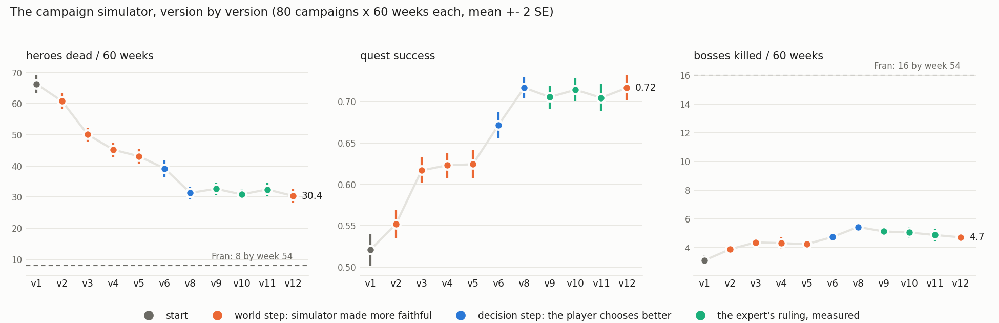

# Learning to play a campaign of Darkest Dungeon — project report (DRAFT)

*Draft of the F3 report (docs/CAMPAIGN_SIM.md). Every number below is this
project's own measurement; the sections marked PENDING wait on runs queued
on 2026-10-12. Nothing in this report reproduces the game's code or data
files: the simulator reads them from the reader's own installation.*

## 1. The problem

Darkest Dungeon is a turn-based roguelike in which a player manages a
roster of heroes over a campaign of weeks: recruiting, levelling, equipping
and treating them in a town, and sending parties of four on expeditions
whose fights are permanent-death. A good campaign is a long chain of
decisions under uncertainty at three time scales — the turn, the
expedition, and the week — and the cost of a mistake (a dead veteran)
arrives many decisions after it was made.

The project builds a player for the whole loop and asks how far each kind
of method gets:

| layer | decision | method |
|---|---|---|
| combat | which skill, on whom, every turn | reinforcement learning (MaskablePPO) |
| expedition | route, curios, camping, retreat | algorithmic, priced in gold |
| town / campaign | quest, party, upgrades, recruits, treatment | algorithmic, an expert player's rules |

The split is deliberate: the combat layer is where the state space is too
large to write rules for, and the rest is where an expert's criteria
(`docs/PLAYBOOK.md`, interviewed from one player) are both available and
auditable.

## 2. The simulator

A faithful numeric reimplementation of the game's combat rules, driven by
the installed game's data files, exposed as a Gymnasium environment. Its
fidelity is the project's main engineering investment: every rule is traced
to a data file or a measured game behaviour, and independent oracles
checked against the running game (damage, hit chance) are kept green.

**Lesson recorded early: fidelity beats compute.** The evaluation's own noise
(~3 pp) was larger than any training improvement measured at the time, so
fidelity fixes — not longer training — were what moved the policy in the
real game.

## 3. The combat policy

- MaskablePPO (sb3-contrib), observation width 1,836, illegal actions masked.
- Reward: win/loss and death terms plus potential-based shaping Φ (hero HP,
  stress, Death's Door, afflictions), so the shaping cannot change the
  optimal policy (Ng, Harada & Russell 1999); non-potential terms are added
  only as named, measured experiments.
- Recipe: 12M steps, 12 environments, batch 256, linear learning-rate decay
  (≈2 h 50 min on one desktop).

**Evaluation.** A reproducible ruler: 446 party compositions × 3 expedition
lengths × 4 seeds = 5,352 episodes per checkpoint, paired by scenario.
SUCCESS (completed, no retreat, no death) of the shipped checkpoint:
**97.4% short / 94.6% medium / 84.1% long**.

**Findings that shaped the method** (`docs/findings/INDEX.md` holds all of
them with their verdicts):
- *One seed is not evidence.* Between-seed variance exceeds the paired
  standard error; every training claim is replicated on two seeds.
- *The training-time best checkpoint is a guess by a bad ruler:* the final
  weights beat `best_model.zip` on every band (+6.7 pp on long expeditions).
- *The optimiser was untuned:* linear LR decay was the largest single-flag
  gain, and it moved the training-budget knee from 6M to 12M.
- *An observation the policy demonstrably uses:* a threat forecast
  (McNemar p = 0.013); its refinements were null.
- *Zero-shot transfer to unseen hero classes is closed* after five
  mechanisms and five nulls; a new class needs data, not architecture.

## 4. The campaign simulator (F1–F2)

The combat simulator is wrapped in a week loop: a quest board, the town's
buildings and upgrades, recruits, heirloom currencies, quest-end quirks and
diseases, using the *same* decision code the live player runs, so an
improvement found in simulation reaches the live player unchanged.

**Calibration.** Against the expert's own recorded campaign: heirloom income
per raid agrees on deeds (3.1 vs 3.3), runs low on crests and portraits; the
first raids were checked fight by fight, which found an engine bug (a hero
resting on Death's Door rolled a deathblow every turn).

**The learning curve** (80 campaigns × 60 weeks per point, mean ± 2 SE):

From 66 to 31 heroes dead per 60 weeks. **Read it in two colours:** 23 of
the 35 come from making the simulator more faithful (two economy bugs that
underpaid every raid, one engine bug), and 12 from the two decision fixes
that are the player improving — the only steps that moved quest success
(0.62 → 0.72), each replicated on two seed blocks. The method lesson: a
simulator improvement and a policy improvement look identical on a single
curve, and only the bookkeeping tells them apart.

The last point, v12, is a world step too: buildings now open when the
game opens them (the Guild and the Blacksmith after three quests). It
costs nothing measurable, and the first Veteran comes two weeks earlier
on both seed blocks.

**Against the expert.** Still about 4× the deaths (30 vs 8) and a third of
the bosses (5 vs 16) over a comparable span.

## 5. The expert's rulings, measured (2026-10-12)

| ruling | result |
|---|---|
| Guild and Blacksmith before the Stage Coach, the vanilla roster managed | null on deaths (+2.0 / +0.7 per 60 weeks, under 2 SE); roster growth unchanged |
| Boss parties at the highest level the quest allows, fully equipped | dead -0.8 / -2.9: favourable on both blocks, 2 SE on one (unreplicated) |
| Sanitarium: cure diseases, remove the worst quirks, lock the best | diseases 8.4 -> 0.5 and 12 fewer negative quirks for 81k gold; deaths null; the first Veteran 2.5-4.9 weeks later (a patient misses the week's raid) |
| Death's Door: train the policy to keep downed heroes out of reach | null, pre-registered (E22): a per-deathblow-roll penalty moved deaths per Death's Door entry 0.140 -> 0.164 (wrong way, under 2 SE) on the first seed, so it failed its falsifier; it cut entries instead (-2.0 SE). Not promoted |

## 6. What did not work (kept, because it is most of the learning)

- Stepping down a difficulty when no party meets a quest's level: harmful
  (+3 dead per campaign), reverted.
- A stricter under-level rule (none at all, or at most one level short):
  null twice.
- A boss level margin of +1: fewer deaths, but bosses killed fell from 5.4
  to 1.5 — a trade, left to the expert.
- A knob whose first run read +12.8 dead was a bug in the knob (a flat
  sentinel tied every violating party and undid a sort); a huge effect from
  a harmless-looking change is a bug signal first.

## 7. The chronicle (F3)

`python -m campaign.chronicle --best <run>` tells the best simulated
campaign week by week from its logs alone: every raid and its party, each
death with the hero's level and raids survived, bosses, wipes, Sanitarium
visits. It is the script the campaign video is cut from. PENDING: hero
names and what the video needs on top (the expert's call).

## 8. Reproducing

`docs/COMMANDS.md` holds every command; the campaign figure is
`python -m campaign.curve --png docs/figures/campaign_curve.png`, and each
experiment's command, falsifier and verdict is in `docs/CAMPAIGN_SIM.md`.
